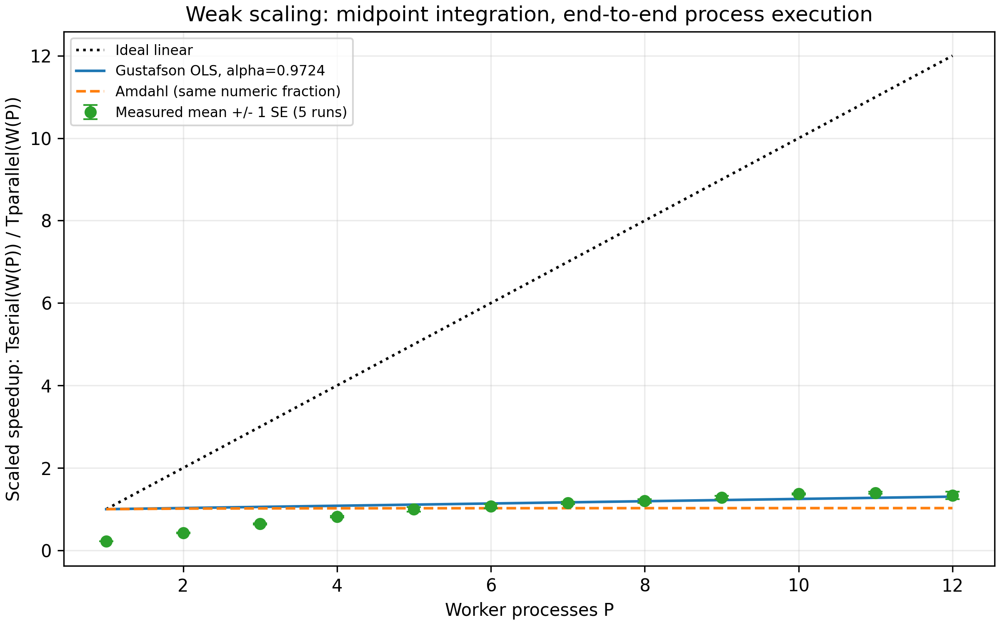

# Gustafson's Law and Weak Scaling: Tasks 01-25

Individual practice submission for Parallel & Distributed Computing Architecture, instructor Sufyan bin Uzayr. Author/student: Issayev Bauyrzhan, 230103303. The dedicated `gustafson-law-practice/` folder satisfies the task sheet's branch-or-folder convention. The work is written in English to match the assignment. This folder is independent of the earlier practicum at repository root.

## Contents

- [Engineering synthesis](#engineering-synthesis)
- [Reproduce the experiments](#reproduce-the-experiments)
- [Task and artifact index](#task-and-artifact-index)
- [Experimental finding](#experimental-finding)
- [References](#references)

## Engineering synthesis

Gustafson's S(P)=P-alpha(P-1) describes an expanded workload executed within roughly constant parallel time. Alpha is the serial fraction measured on the parallel machine. Amdahl's S(P)=1/[s+(1-s)/P] describes a fixed workload, with s measured on one processor. For a common ideal workload, alpha=P*s/[1+(P-1)*s], so the formulas agree after changing reference frames. Do not substitute the same numeric fraction and infer a contradiction.

For invariant alpha, efficiency tends to 1-alpha. Fixed-size efficiency tends to zero for any fixed s>0. A well-behaved weak-scaling program therefore needs enough useful work to amortize serial stages as resources grow, adequate memory and approximately bounded local communication and imbalance. Isoefficiency is Theta(P) in the simple constant-serial-stage model; exposed tree latency can raise the required work growth to P log P.

Choose weak scaling when additional resources have scientific or business value through larger ensembles, grids or datasets within a deadline. Monte Carlo with independent streams and bounded reductions is a favorable design. Dense GEMM needs N proportional to P^(1/3) for fixed compute time, not N proportional to P. A balanced 3D stencil keeps local surface/volume constant under volume weak scaling. All-pairs N-body and irregular graph workloads require a different growth schedule or stronger partitioning: input elements per processor alone do not guarantee constant computational time.

Memory-bounded scaling chooses expanded work by capacity and can permit a different growth rate from fixed-time scaling. State bytes per cell and buffer replication before giving memory ceilings. Count communication absent from serial execution as a penalty, not useful serial work. Track energy-to-solution separately from time: powering more nodes can increase total energy even while throughput grows.

For production decisions, define workload growth, stopping tolerance, timing scope and a same-work sequential reference. Measure rather than assume alpha, and reject a fitted law that misses its intercept or requires a nonphysical parameter. Five repeats and error bars reveal variability; they do not establish thermal or NUMA causes without instrumentation.

## Reproduce the experiments

From the personal Git repository root, with Python 3.10+:

```powershell
python -m pip install -r gustafson-law-practice/requirements.txt
python gustafson-law-practice/benchmarks/simulator.py
python gustafson-law-practice/benchmarks/weak_scale_bench/benchmark.py --k 500000 --runs 5
python gustafson-law-practice/benchmarks/fit_gustafson.py
python gustafson-law-practice/verify_submission.py
```

On the submission host the working interpreter is `C:\Users\isaev\AppData\Local\Programs\Python\Python314\python.exe`. In PowerShell substitute `& 'C:\Users\isaev\AppData\Local\Programs\Python\Python314\python.exe'` for `python` if the Windows alias is unavailable. Matplotlib is needed only for plotting. The benchmark uses the standard library, creates one pool per measured run, and defaults to every visible logical processor count. It overwrites its selected output file; preserve the submitted CSV before collecting a different experiment.

Simulator example with custom inputs:

```powershell
python gustafson-law-practice/benchmarks/simulator.py --max-p 1024 --alphas 0.001 0.04 0.2 --output custom-simulation.csv
```

The submitted simulator dataset uses all integer counts 1..65536 and alpha values .001, .04, .08, .20 (262144 rows). Arbitrary fractions in [.001,.20] are accepted by the CLI. No compiler, BLAS or NumPy is required. The verifier checks actual numerical consistency, reference-frame equivalence, known synthetic regression, raw trial counts, pi accuracy, summary statistics, every simulator row, artifact existence and local documentation links. It exits nonzero on failure.

## Task and artifact index

| Task | Submitted answer / source |
|---:|---|
|01|[Scaling models](theory/task01_scaling_models.md)|
|02|[First-principles derivation](theory/task02_derivation.md)|
|03|[Serial-fraction invariance](theory/task03_serial_invariance.md)|
|04|[Asymptotic limits](theory/task04_asymptotic_limits.md)|
|05|[Historical nCUBE reconstruction](theory/task05_historical_ncube.md)|
|06|[Parametric numeric table](calculations/task06_parametric_table.md)|
|07|[Tolerable overhead](calculations/task07_tolerable_serial.md)|
|08|[Amdahl/Gustafson divergence](calculations/task08_cross_divergence.md)|
|09|[Multicomponent workload](calculations/task09_multicomponent.md)|
|10|[Memory ceiling](calculations/task10_memory_growth.md)|
|11|[Sun-Ni comparison](theory/task11_sun_ni_comparison.md)|
|12|[Communication penalty](theory/task12_communication_penalty.md)|
|13|[Failure cases](theory/task13_failure_cases.md)|
|14|[Isoefficiency proof](theory/task14_isoefficiency.md)|
|15|[Energy model](theory/task15_energy_scaling.md)|
|16|[GEMM targets](calculations/task16_gemm_scaling.md)|
|17|[Stencil surfaces and volume](calculations/task17_stencil_scaling.md)|
|18|[N-body comparison](analysis/task18_nbody_scaling.md)|
|19|[Monte Carlo and reduction trees](analysis/task19_monte_carlo.md)|
|20|[Graph processing](analysis/task20_graph_processing.md)|
|21|[Simulator source](benchmarks/simulator.py), [CSV](benchmarks/simulator.csv), [PNG](benchmarks/simulator.png), [vector SVG](benchmarks/simulator.svg)|
|22|[Benchmark source](benchmarks/weak_scale_bench/benchmark.py), [run instructions](benchmarks/weak_scale_bench/README.md)|
|23|[Raw trials](benchmarks/results.csv), [summary](benchmarks/summary.csv), [fit script](benchmarks/fit_gustafson.py), [fit JSON](benchmarks/fit.json), [environment](benchmarks/environment.json), [method and results](analysis/task23_experimental_results.md)|
|24|[Hardware and discrepancy audit](analysis/task24_hardware_audit.md), [300 dpi PNG](plots/scaling_comparison.png), [vector SVG](plots/scaling_comparison.svg)|
|25|This master guide, also linked from the personal repository's root README|

Supporting artifacts: [requirements](requirements.txt) and [submission verifier](verify_submission.py). Generated Python caches are excluded from new submissions by the repository `.gitignore`.

## Experimental finding

The real dataset contains 60 trials: P=1..12 and five independent process-pool launches per count, on a 6-core/12-thread i5-11400H. For k=500000 samples per process, mean scaled speedup is .2051 at P=1 and 1.0043 at P=12. The highest measured mean is 1.1629 at P=11. End-to-end timing includes interpreter/process startup; this short scalar Python workload does not deliver ideal weak scaling.

Unconstrained least squares gives alpha=1.0056894651. Constraining alpha to [0,1] gives 1, with RMSE=.3455265353 and R^2=-.5377054902. These are documented model failures, not evidence that every instruction in the program is serial. Retaining the negative result is necessary for a meaningful empirical comparison. The coinciding fitted Amdahl and Gustafson lines at alpha=1 are shown with distinct line styles in the plot. Thermal and NUMA explanations remain unverified because those counters were not measured.



## References

- [Gustafson, Reevaluating Amdahl's Law (1988), primary paper](https://citeseerx.ist.psu.edu/document?doi=2514eef3fd17294045718403263224fc9f35f75d&repid=rep1&type=pdf).
- [Sun and Ni, Scalable Problems and Memory-Bounded Speedup (1993), primary paper](https://www.cs.iit.edu/~scs/psfiles/Sun_and_Ni_JPDC1993.pdf).
- [Intel i5-11400H official specifications](https://www.intel.com/content/www/us/en/products/sku/213805/intel-core-i511400h-processor-12m-cache-up-to-4-50-ghz/specifications.html).

Historical discussion is distinguished from this submission's measured experiment. Numeric illustrations in Tasks 05, 10, 15 and 19 state their assumptions and are not empirical timing claims.
